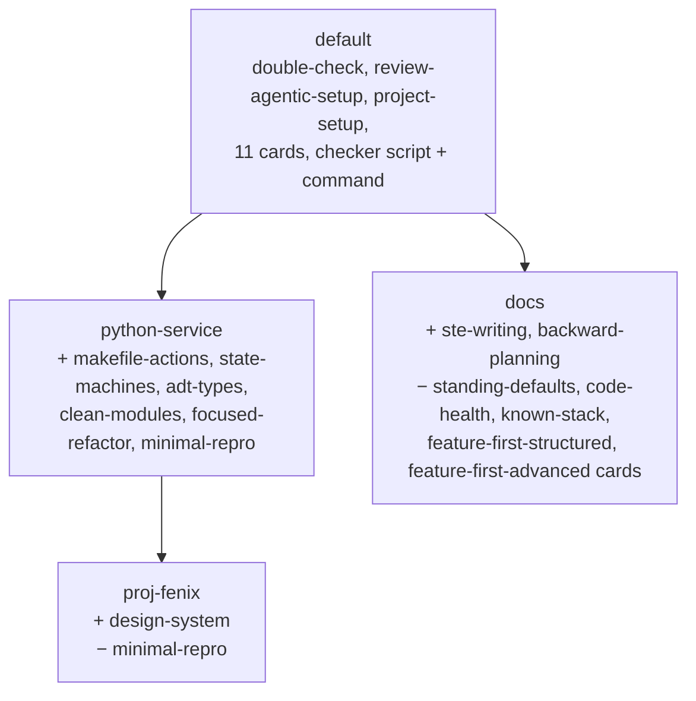

# ast-repo: a demo org repo for ast

This repo shows how an organisation can publish its agent setup with
[`ast`](https://github.com/epatel/ai-setup-tool). It holds named **sets** of tools. A project selects one set, and
`ast` installs the tools of that set into the project and keeps them current.

The content follows the patterns of https://ai.memention.net/setup: skills from
`epatel/agent-skills`, the project-setup skill, the standing-defaults card and the
agent-docs checker.

## What is in here

| Path | What it is |
| --- | --- |
| `ast-org.toml` | The sources and the sets. This is the file that `ast` reads. |
| `CARDS.md` | One line per card that says when to read it. `ast` copies these lines into a project's card index. |
| `cards/standing-defaults.md` | Card from ai.memention.net: Python venv and migration-path defaults. |
| `cards/agent-setup.md` | Card that tells agents and people how the installed tools are managed. |
| `cards/code-health.md` | Card from ai.memention.net: aihealth code-health feedback via hooks, MCP and a pinned venv install. |
| `cards/cards-instructions.md` | Card from ai.memention.net: the context-card model and the rules for adding or changing a card. |
| `cards/cards-procedure.md` | Card from ai.memention.net: Steps 0–5 for populating context cards in an existing project. |
| `cards/hooks-over-prose.md` | Card from ai.memention.net: move checkable "always/never" rules from CLAUDE.md into `.claude/settings.json` hooks. |
| `cards/known-stack.md` | Card from ai.memention.net: name mainstream frameworks in one line instead of carding them. Experimental. |
| `cards/two-tier-claude-md.md` | Card from ai.memention.net: split feature `CLAUDE.md` files into a slim auto-loaded overview and an on-demand contract. |
| `cards/project-plan.md` | Card from ai.memention.net: a shared `project-plan.md` that keeps parallel agents on one goal and state. |
| `cards/feature-first-structured.md` | Card from ai.memention.net: features as directories, each a pipeline of hookable named nodes. |
| `cards/feature-first-advanced.md` | Card from ai.memention.net: peer hooks between features and per-request middleware, on top of feature-first-structured. |
| `scripts/check-agent-docs.py` | Checker from ai.memention.net for `CLAUDE.md` imports, the card index and the setup record. Read-only, standard library only. |
| `prompts/setup.md` | Steps that `ast prompt setup epatel/ast-repo` adds after the tools are installed: assess the project, propose the patterns below, apply the confirmed ones, verify. |
| `prompts/<pattern>.md` | One prompt for each ai.memention.net pattern (`known-stack`, `context-cards`, `feature-first`, `feature-first-advanced`, `two-tier`, `project-plan`, `standing-defaults`, `hooks-over-prose`, `code-health`), plus `anthropic-skills` and `install-tools`. A project prints one with `ast prompt <name>`. Each includes its pattern text from `cards/`. |
| `commands/check-agent-docs.md` | Slash command `/check-agent-docs` that runs the script and explains the findings. |

Skills are not copied into this repo. The sets refer to them in their own repos.

## The sets



A set is everything its `extends` parents give, plus its own `tools`, minus its own `exclude`.

| Set | Tools | For |
| --- | --- | --- |
| `default` | 16 | Baseline for every project |
| `python-service` | 22 | Python services and command-line tools |
| `docs` | 13 | Documentation and writing projects |
| `proj-fenix` | 22 | One project that needs its own mix |
| `memention-setup` | 4 | Only what ai.memention.net/setup copies into a project: the review skill, the standing-defaults card, the checker script and command. Extends nothing. |

## Use it in a project

The short way, with a coding agent: run `ast prompt setup epatel/ast-repo` and tell the agent
to follow the output. It picks the set that fits the project and reports what it installed.

By hand:

```sh
cd my-project
ast init
ast use epatel/ast-repo        # this repo on GitHub; a git URL or a local path also works
ast select                     # list the sets
ast select python-service      # install that set
ast list                       # see each tool and the set it comes from
```

Then adjust the project without changing the org repo:

```sh
ast disable minimal-repro      # turn one tool of the set off
ast add ste-writing            # add a tool the set does not have
```

`ast` also lists the installed cards in the project's `CARDS.md` and adds `@CARDS.md` to
`CLAUDE.md`, so agents know when to read each card. The text of each line comes from
[`CARDS.md`](CARDS.md) in this repo.

## Change the org repo

Run `ast` inside this repo. It sees `ast-org.toml` and acts on the sets.

```sh
ast list                                   # every set, resolved
ast list --available                       # tools that no set uses
ast add focused-refactor --set docs        # add a tool to a set
ast disable double-check --set docs        # exclude an inherited tool
ast set new proj-atlas --extends docs --description "Project Atlas"
ast status                                 # check that every tool still exists
```

To add a tool of your own, put it in `cards/`, `commands/`, `scripts/`, `agents/` or
`skills/<name>/SKILL.md`, then run `ast add <name>`.

Commit and push. Each project gets the change when it runs `ast update`; before that,
`ast status` in the project shows what the update will install, change and remove.

A project reads `ast-org.toml` from git, not from your working tree, so a change that is
not committed and pushed does not reach any project.
