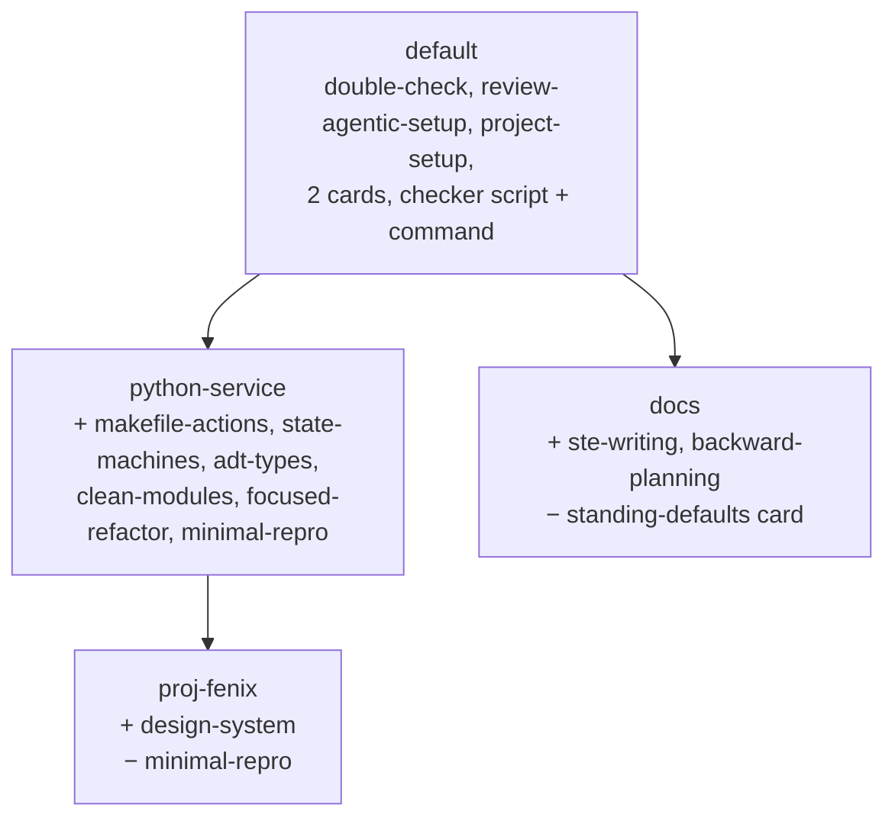

# ast-repo: a demo org repo for ast

This repo shows how an organisation can publish its agent setup with
[`ast`](../ai-setup-tool). It holds named **sets** of tools. A project selects one set, and
`ast` installs the tools of that set into the project and keeps them current.

The content follows the patterns of https://ai.memention.net/setup: skills from
`epatel/agent-skills`, the project-setup skill, the standing-defaults card and the
agent-docs checker.

## What is in here

| Path | What it is |
| --- | --- |
| `ast-org.toml` | The sources and the sets. This is the file that `ast` reads. |
| `cards/standing-defaults.md` | Card from ai.memention.net: Python venv and migration-path defaults. |
| `cards/agent-setup.md` | Card that tells agents and people how the installed tools are managed. |
| `scripts/check-agent-docs.py` | Checker from ai.memention.net for `CLAUDE.md` imports, the card index and the setup record. Read-only, standard library only. |
| `commands/check-agent-docs.md` | Slash command `/check-agent-docs` that runs the script and explains the findings. |

Skills are not copied into this repo. The sets refer to them in their own repos.

## The sets



A set is everything its `extends` parents give, plus its own `tools`, minus its own `exclude`.

| Set | Tools | For |
| --- | --- | --- |
| `default` | 7 | Baseline for every project |
| `python-service` | 13 | Python services and command-line tools |
| `docs` | 8 | Documentation and writing projects |
| `proj-fenix` | 13 | One project that needs its own mix |

## Use it in a project

```sh
cd my-project
ast init
ast use epatel/ast-repo        # this repo on GitHub; a git URL or a local path also works
ast select                     # list the sets
ast select python-service      # install that set
ast list                       # see each tool and the set it comes from
```

Then adjust the project without changing the org repo:

```sh
ast disable minimal-repro      # turn one tool of the set off
ast add ste-writing            # add a tool the set does not have
```

`ast` copies cards into `cards/` but does not edit `CLAUDE.md`. Add the index lines yourself:

```markdown
- [standing-defaults](cards/standing-defaults.md) — installing a Python dependency, or changing a stored schema
- [agent-setup](cards/agent-setup.md) — adding, changing or updating a skill, command, script or card
```

## Change the org repo

Run `ast` inside this repo. It sees `ast-org.toml` and acts on the sets.

```sh
ast list                                   # every set, resolved
ast list --available                       # tools that no set uses
ast add focused-refactor --set docs        # add a tool to a set
ast disable double-check --set docs        # exclude an inherited tool
ast set new proj-atlas --extends docs --description "Project Atlas"
ast status                                 # check that every tool still exists
```

To add a tool of your own, put it in `cards/`, `commands/`, `scripts/`, `agents/` or
`skills/<name>/SKILL.md`, then run `ast add <name>`.

Commit and push. Each project gets the change when it runs `ast update`; before that,
`ast status` in the project shows what the update will install, change and remove.

A project reads `ast-org.toml` from git, not from your working tree, so a change that is
not committed and pushed does not reach any project.
